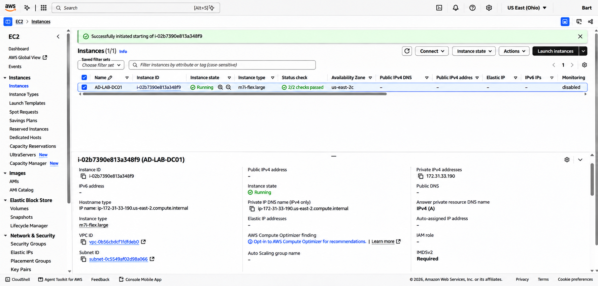
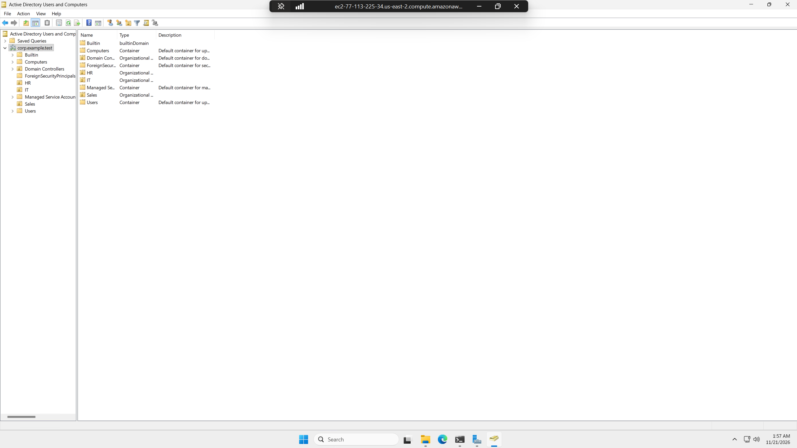
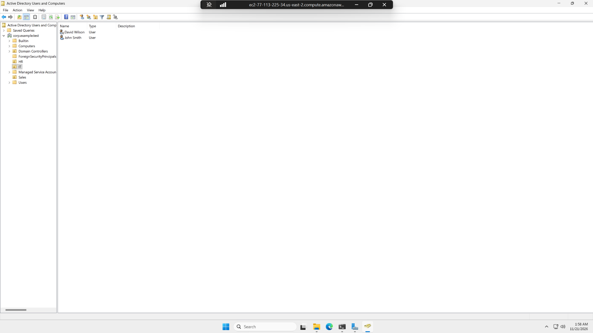
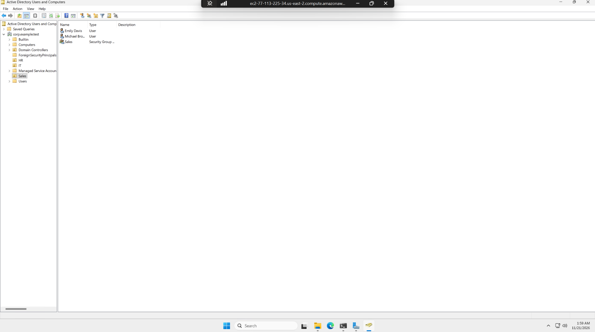
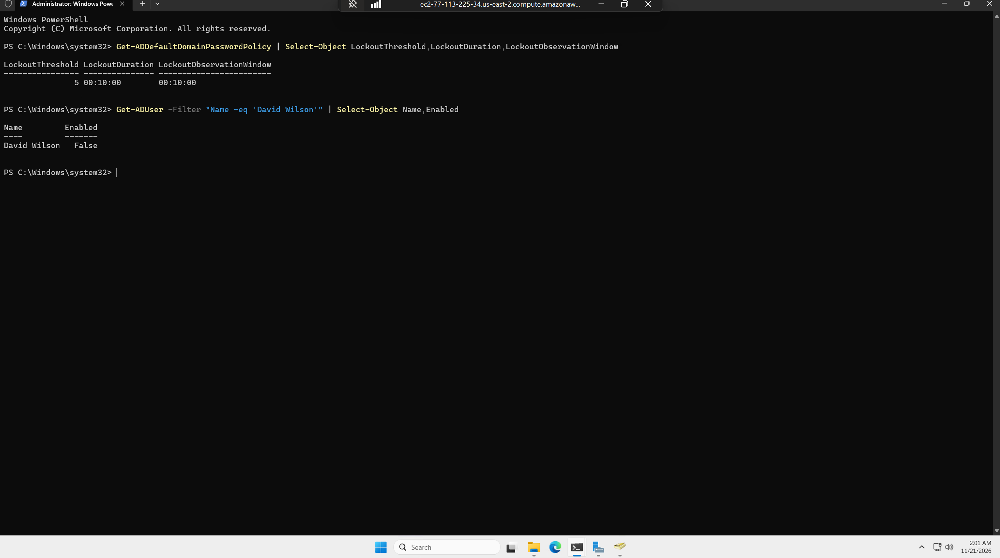
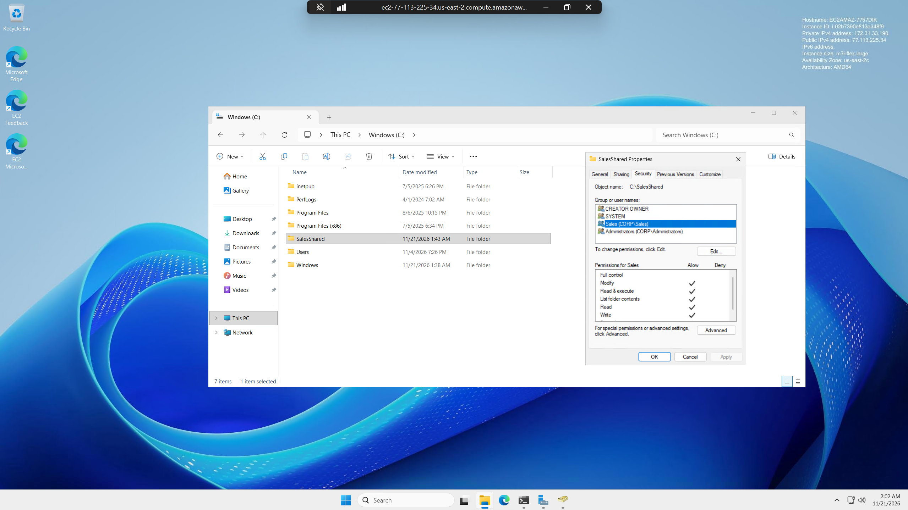
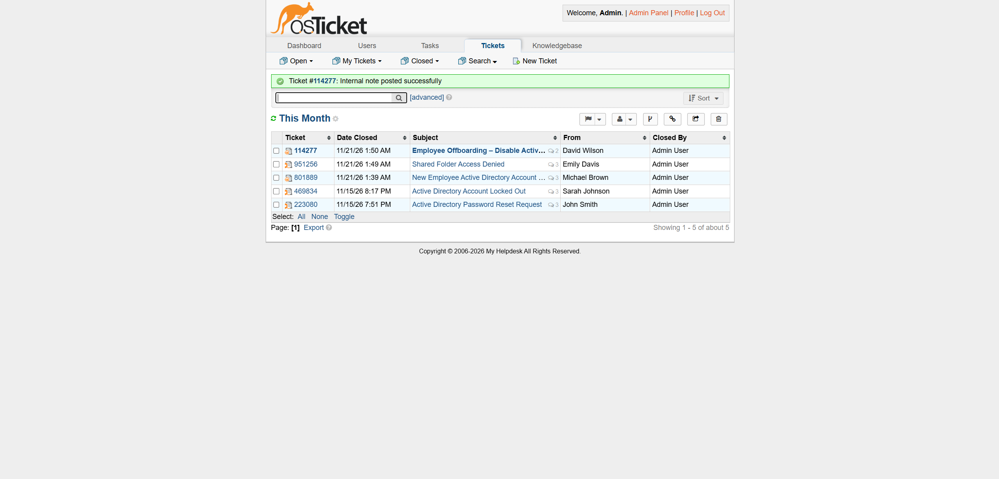
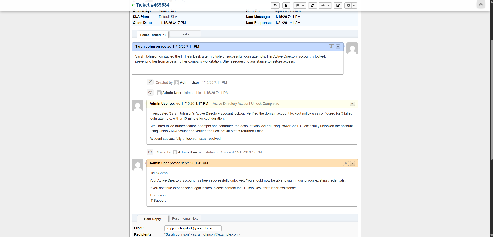
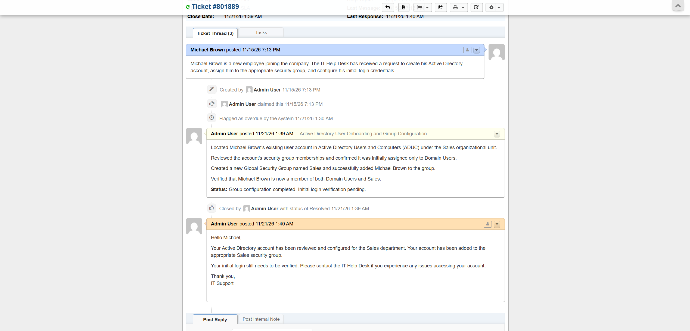

# AWS Active Directory & osTicket Help Desk Lab

## Project Overview

### AWS EC2 — Windows Server 2022

Built a simulated enterprise IT help desk environment using Amazon Web Services (AWS), Windows Server 2022, Active Directory Domain Services (AD DS), Ubuntu Linux, Docker, and osTicket.

The project demonstrates foundational IT support skills, including user account administration, security group management, account lockout troubleshooting, shared folder permissions, PowerShell verification, and IT ticket documentation.

## Technologies Used

- **AWS EC2:** Hosted a Windows Server 2022 virtual machine.
- **Windows Server 2022:** Configured as an Active Directory domain controller.
- **Active Directory Domain Services:** Managed users, organizational units, and security groups.
- **PowerShell:** Verified account status and domain password policies.
- **Ubuntu Linux & Docker:** Hosted the osTicket help desk application locally.
- **osTicket:** Created and documented simulated IT support requests.
- **Windows File Sharing:** Configured SMB and NTFS permissions.

## Lab Environment

Created the Active Directory domain `corp.example.test` with three organizational units:

- **HR:** Sarah Johnson
- **IT:** David Wilson and John Smith
- **Sales:** Emily Davis and Michael Brown

Created a Sales security group to manage access to shared resources.

## Help Desk Scenarios

### 1. Account Lockout — Sarah Johnson

Configured an Active Directory account lockout policy with a threshold of five failed sign-in attempts and a ten-minute lockout duration.

Simulated an account lockout, investigated the issue, unlocked the account, and verified the result using PowerShell.

### 2. Security Group Membership — Michael Brown

Reviewed the user's Active Directory account and configured membership in the Sales security group.

Verified group membership and documented the changes in osTicket.

### 3. Shared Folder Access — Emily Davis

Created `C:\SalesShared` and configured Windows file sharing permissions.

Granted the Sales security group Modify NTFS permissions and Change/Read share permissions. Verified effective access using Windows security settings.

An end-user network access test was not performed.

### 4. Employee Account Deactivation — David Wilson

Disabled the user's Active Directory account as part of a simulated employee offboarding request.

Verified the account was disabled using PowerShell:

`Get-ADUser -Filter "Name -eq 'David Wilson'" | Select-Object Name,Enabled`

The command returned `Enabled = False`.

### 5. Additional Help Desk Request

Processed and documented an additional simulated support ticket through osTicket.

## Ticket Management

Used osTicket to document five simulated help desk requests, including issue descriptions, internal troubleshooting notes, actions taken, and resolutions.

## Skills Demonstrated

- Windows Server administration
- Active Directory user and group management
- PowerShell troubleshooting
- Group Policy and account lockout configuration
- NTFS and SMB share permissions
- Linux and Docker fundamentals
- Help desk ticket management
- Technical documentation

## Project Evidence

Screenshots of the AWS environment, Active Directory configuration, PowerShell commands, folder permissions, and osTicket workflows are available in the [`screenshots`](screenshots/) directory.

## Key Takeaways

This hands-on project strengthened my understanding of how IT support technicians manage user accounts, troubleshoot access issues, apply security policies, and document support requests in an enterprise-style environment.

**Environment:** Educational lab using simulated users and support tickets.
## Project Screenshots

### Active Directory Domain Structure

### HR Organizational Unit

### IT Organizational Unit

### Sales Organizational Unit

### Account Lockout Policy & Account Deactivation

### Shared Folder Permissions

### osTicket — Completed Tickets

### osTicket — Account Lockout Troubleshooting

### osTicket — User Onboarding

